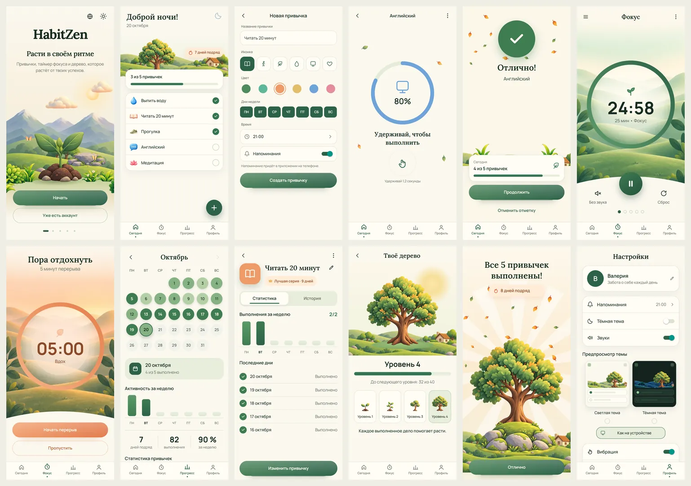
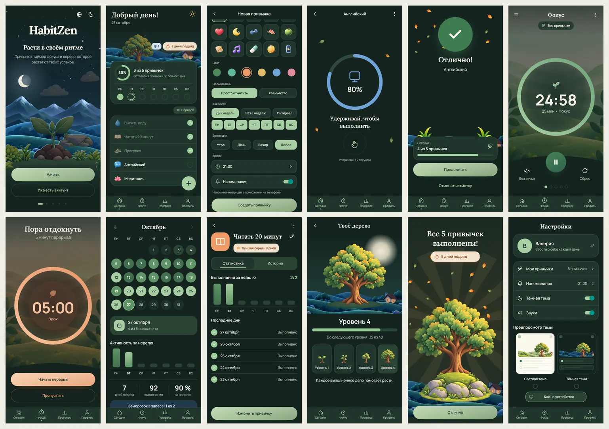
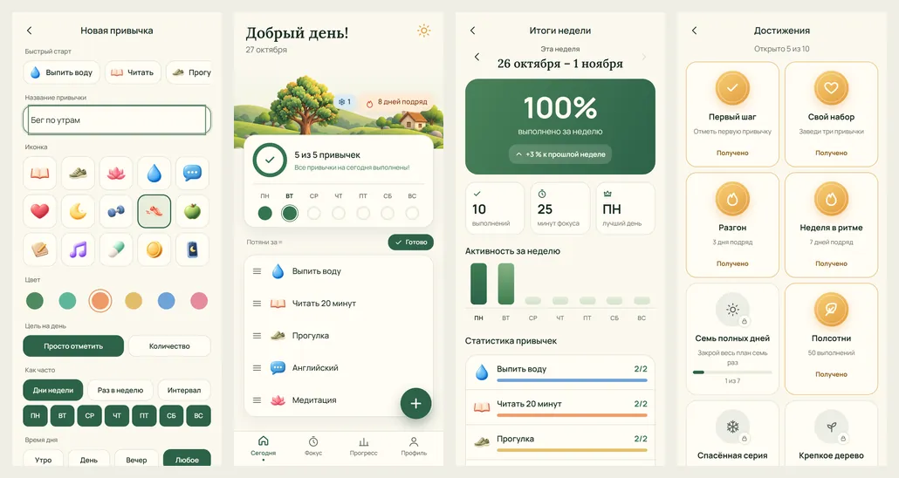

# HabitZen

Привычки, фокус и маленькие победы. Мобильное приложение на Expo/React Native с сервером на Supabase (PostgreSQL): план на день с жестом удержания, таймер 25/5 с дыханием и звуками природы, календарь и статистика, дерево, которое растёт от выполненных дел, награда за полный день и напоминания. Привычки с количеством («8 стаканов» и кнопка «+»), гибкий график, разделы «Утро / День / Вечер», заморозка серии, «Итоги недели» и годовая карта. Три языка (русский, украинский, английский), светлая и тёмная тема и четыре цветовые темы.

<p align="center">
  
</p>

**Видео с Android-эмулятора:** [docs/media/habitzen-android.mp4](docs/media/habitzen-android.mp4).

## Экраны

Все 12 кадров макета ([resources/design/reference.png](resources/design/reference.png)), светлая и тёмная тема:




Сверка с макетом — сверху макет, снизу приложение: [кадры 01–06](docs/screens/mockup-vs-app-1.webp), [кадры 07–12](docs/screens/mockup-vs-app-2.webp). Отдельные экраны — в [docs/screens](docs/screens).

| Кадр                  | Что умеет                                                                                                                |
| --------------------- | ------------------------------------------------------------------------------------------------------------------------ |
| 01 Знакомство         | Живой мир на пяти страницах: день и ночь, волк, листья; выбор языка и темы; регистрация, вход, восстановление пароля     |
| 02 План на день       | Приветствие по времени суток, дерево и серия «N дней подряд», «3 из 5 привычек», свайп влево — «Сегодня отдых»           |
| 03 Новая привычка     | Название, значок (категория), цвет, дни недели, время напоминания; изменение и архив                                     |
| 04 Удержание          | Кольцо 0→100 % за 1,2 с, лёгкая вибрация каждые 200 мс; отпустил раньше — откат. Для читалки экрана — одно касание       |
| 05 «Отлично!»         | Галочка с пружиной 1,15→1, падающие листья, новый прогресс, отмена отметки                                               |
| 06–07 Фокус и перерыв | 25 минут и 5 минут, пауза, сброс, «Завершить раньше»; дыхание 180→240 за 4 с; дождь, лес, белый шум; уведомление о конце |
| 08 Календарь          | Месяц с насыщенностью зелёного по выполнению, карточка дня, неделя, серия, выполнения, процент недели                    |
| 09 О привычке         | Лучшая серия, выполнения за неделю, последние дни и вся история                                                          |
| 10 Твоё дерево        | 10 уровней из выполненных дел, 7 рисунков роста, «Новый уровень!» один раз                                               |
| 11 День завершён      | Однократная награда за полный план: лучи, листья, серия                                                                  |
| 12 Настройки          | Имя, напоминания, тёмная тема, звуки, предпросмотр темы, вибрация, «Меньше движения», язык, выход                        |

Сверх макета (HZ-08–10), в том же стиле:



| Что                | Как работает                                                                                                           |
| ------------------ | ---------------------------------------------------------------------------------------------------------------------- |
| Цель с количеством | «8 стаканов», «20 минут», «10 000 шагов»: «+» с кольцом в плане, «− 3 стакана +» на экране удержания                   |
| Гибкий график      | Дни недели, «3 раза в неделю» (в любой день, по желанию), «каждый 3-й день»                                            |
| Время дня          | План делится на «Утро / День / Вечер / В любое время»                                                                  |
| Фокус для привычки | Выбор привычки над таймером; 25 минут засчитываются в цель «минут» или отмечают привычку                               |
| Заморозка серии    | Каждые 7 выполненных дней — одна заморозка (до двух); она сама закрывает пропуск, серия не обрывается                  |
| Итоги недели и год | Процент с досчитывающим числом, сравнение с прошлой неделей, лучший день, минуты фокуса; годовая карта на «Прогрессе»  |
| Цветовые темы      | «Лес», «Закат», «Океан», «Лаванда» — в «Настройках», вместе со светлой и тёмной; кольцо фокуса тоже                    |
| Мои привычки       | Свой порядок перетаскиванием за «≡» — прямо в плане (кнопка «Порядок») или в «Настройках», и архив с кнопкой «Вернуть» |
| Карточка дня       | Кольцо с процентом, «осталось 2 привычки» и лента недели — кружок на каждый день                                       |
| Быстрый старт      | 9 готовых привычек и 15 цветных значков; значок и цвет подбираются по названию                                         |
| Достижения         | 10 медалей за серии, полные дни, выполнения и рост дерева; новая выезжает плашкой                                      |

## Как это устроено

- **Приложение:** Expo SDK 57, React Native 0.86, Expo Router (вкладки и стек), TypeScript в строгом режиме.
- **Анимации и жесты:** Reanimated 4 (`useAnimatedStyle`, `withSpring`, `withTiming`, `withRepeat`, `withSequence`, анимации появления), Gesture Handler (удержание `Gesture.LongPress`, перетаскивание `Gesture.Pan`, свайп строки), SVG-кольца.
- **Нативные модули:** expo-haptics, expo-notifications (уведомление таймера и ежедневные напоминания), expo-audio (звуки фокуса), SecureStore (сессия).
- **Сервер:** Supabase — Auth и PostgreSQL. Все изменения идут через функции базы с проверкой владельца, версией строки и номером запроса: повтор не удваивает действие, второе устройство не затирает первое. Серия, уровень дерева и награды считаются на сервере из подтверждённых отметок — подделать их из приложения нельзя.
- **Оформление:** дизайн-токены в `packages/design`; анимируемые стили — Reanimated, статичная раскладка — StyleSheet и NativeWind 4 (классы с теми же токенами: «Напоминания», «Достижения», «Мои привычки», «Итоги недели», полоса «Порядок»).
- **Языки:** i18next, словари `resources/locales/{ru,uk,en}`; язык меняется без перезапуска.
- **Ядро без React:** даты, серии, таймер и уровни дерева — `packages/core`, покрыты модульными тестами.

Подробнее: [архитектура](docs/architecture.md), [данные и миграции](docs/data-model.md), [экраны и анимации](docs/ui-spec.md), [решения](docs/decisions.md), [проверки](docs/verification.md).

## Запуск

Нужны Node 24, npm 11 и Docker.

```bash
npm ci
npm run db:start
```

Создать `apps/mobile/.env.local` с адресом и публичным ключом локального Supabase (`npx supabase status -o env`, подробности — [docs/development.md](docs/development.md)), затем:

```bash
npm run web -- --port 8097
```

Открыть `http://localhost:8097`. Android: `npx expo run:android` в `apps/mobile` или сборка через Gradle (команды — в docs/development.md); для эмулятора нужны `adb reverse tcp:8097 tcp:8097` и `adb reverse tcp:55321 tcp:55321`.

## Проверки

```bash
npm run check
npm run db:verify
npm run test:e2e
```

- `check` — типы, ESLint, Prettier, модульные тесты (Vitest) и граница ядра.
- `db:verify` — миграции с нуля во временном PostgreSQL и проверки команд: повторы, конфликты версий, чужие данные, награды, таймер.
- `test:e2e` — сценарии Playwright на настоящем локальном Supabase, включая проверку доступности всех экранов (axe, WCAG 2.1 AA) в обеих темах.
- `npm run screens` и `npm run demo:video` — снимки всех кадров и видео-прохождение; галерею собирают скрипты в `resources/design/screens`.

Результаты последнего прогона — в [docs/verification.md](docs/verification.md).

## Доступность

Подписи у всех кнопок и полей, роли вкладок и переключателей, контраст текста WCAG AA в светлой и тёмной теме (проверяется автоматически). Удержание и меню строки доступны читалке экрана без жестов. Системное «Уменьшение движения» и собственный выключатель «Меньше движения» убирают покачивание, частицы и прыжки; вибрацию можно выключить. Крупный системный шрифт поддерживается, а текст внутри колец и кружков календаря растёт в разумных пределах.

## Ограничения

- Заморозка серии появляется только после 7 выполненных дней; без неё пропуск, как в задании, обнуляет серию.

- iOS не проверялся: нет Mac и Xcode. Код не использует ничего только для Android.
- В браузере напоминаний и вибрации нет — они работают в приложении на телефоне.
- Без отдельного разрешения Android ставит «неточный» будильник: уведомление о конце таймера может прийти с задержкой до минуты.
- Напоминание о привычке приходит и в том случае, если её уже отметили: уведомления ставятся заранее.
- Напоминания «N раз в неделю» и «каждый N-й день» ставятся на 1–3 недели вперёд и обновляются, когда открываешь приложение.

## Откуда графика и звук

Иллюстрации мира, дерева, фонов фокуса и значков привычек подготовлены по макету отдельно от кода, рабочие файлы — в отдельной папке HabitZen-Art. Звуки дождя, леса и белого шума синтезированы скриптом [resources/design/sounds/make_focus_sounds.py](resources/design/sounds/make_focus_sounds.py). Шрифты Lora и Manrope — по лицензии SIL OFL ([resources/licenses](resources/licenses)).
